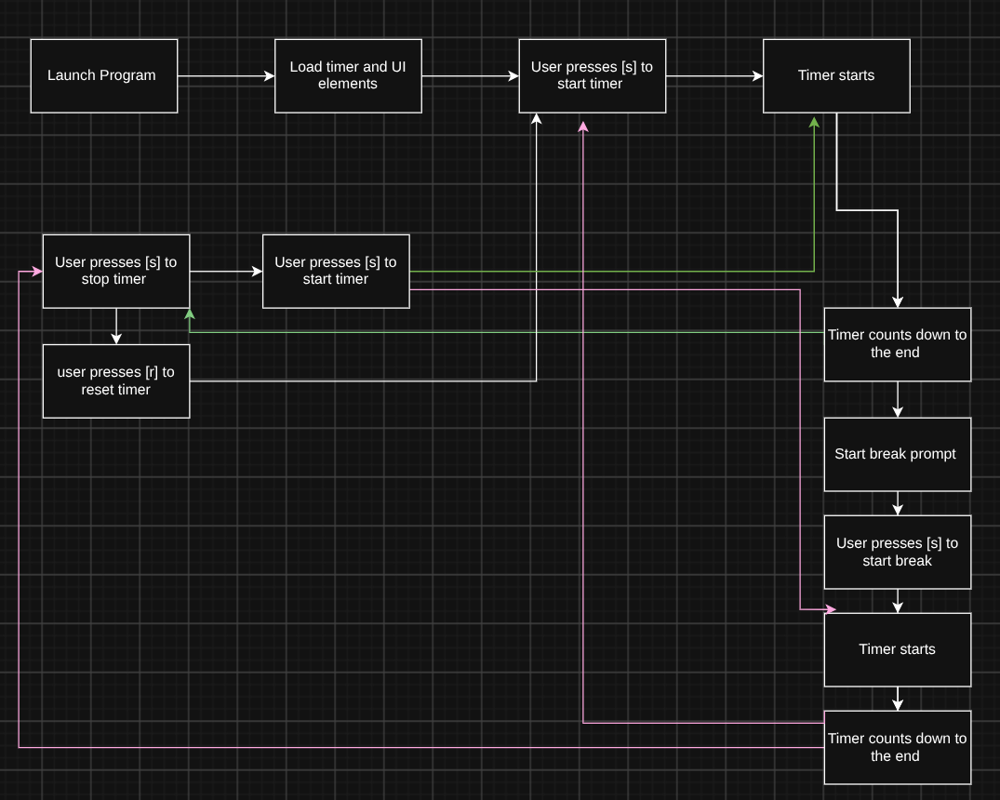

# TUI-Pomodoro

## Project Goal
Create a simple easy to use pomodoro TUI application in Bash

## MVP Scope
Ability to start a pomodoro session of 30 minutes and a break of 5 minutes and the ability to start/stop/reset the timer.

## Future Plans
Customization for the application, notifications, sound effects 

## Tech Stack
Bash
Bash TUI toolkit

## Eisenhower Matrix & System Diagram
 
|                | **Urgent**                  | **Not Urgent**              |
|----------------|-----------------------------|-----------------------------|
| **Important**  | **Do - (Your MVP)**         | **Schedule - (For V2.0+)**  |
|                | • Timer functionality| • Rewind time |
|                | • Break functionality | • Custom timer length |
|                | • Start/Stop timer | • Auto start/stop |
| **Not Important** | **Delegate - (Use a library)** | **Delete - (Cut it)**   |
|                   | • Making the UI Pretty| • Custom notification sounds |
|                   | • Notifications | • Custom color pallet selector |
|                   | • Sound effects | • Preset timers |

